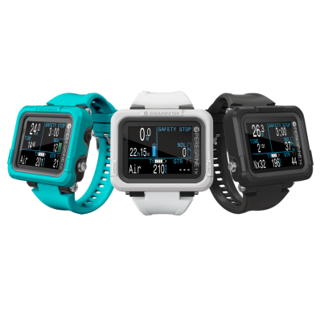
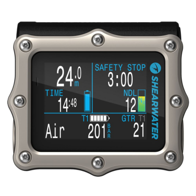
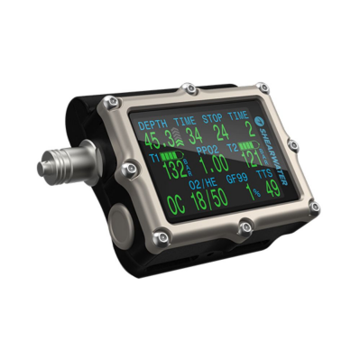
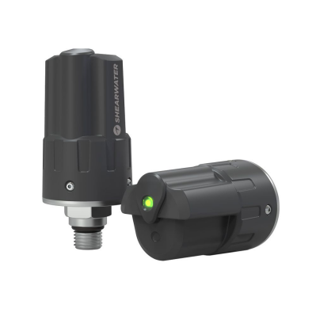

## Peregrine TX

{: style="float: right"}

Shearwater Peregrine TX Är uppföljaren till Peregrine. Denna är utrustad med digital kompass och integration för trådlös avläsning av flasktrycket, [sändare](#swift) säljs separat.
Peregrine TX lämpar sig för så väl nya som mer avancerade dykare med upp till tre gasbyten för accelerad dekompression.
Peregrine TX har en tydlig och lättläst display och enkla knapptryckningar för att navigera i menyerna.
Finns att tillgå i tre färger: svart, ljusgrå och turkos.

Dyklägen:

- Luft
- Nitrox (max 40% syre)
- 3 gas Nitrox (max 100% syre)
- Bottomtimer

{:style="clear: right"}

## Perdix 3

{: style="float: right"}

Perdix 3 är den senaste generation av Shearwaters flaggskepps modell. Med en 2.4 tums Amoled skärm där dykaten kan både storlek och position på den information som skall visas ges oandliga anpassnings möjligheter.Går att komplettera med trådlös sändare för att visa flasktrycket på upp till 4st flaskor. [Sändare](#swift) säljs separat.
Finns att tillgå i svart eller silver.

Dyklägen:

- OC rec (Nitrox rekreationsdykning)
- OC Tec (Multi gas, trimix dekompression)
- CC/BO (Rebrateher med fast pO2 setpoint)
- Bottomtimer

{:style="clear: right"}

## Petrel 3

{: style="float: right"}

Petrel 3 är den senaste generationen av Shearwaters mer avancerade datorer. Med möjlighet att koppa in 4 sändare och pO2 övervaknig via fisher eller 4-pin kontakt. [Sändare](#swift) säljs separat.

Dyklägen:

- OC rec (Nitrox rekreationsdykning)
- OC Tec (Multi gas, trimix dekompression)
- CC/BO (Rebrateher med fast pO2 setpoint)
- CC/BO (Rebreather med pO2 övervaknig via kabel)
- Bottomtimer

{:style="clear: right"}

## Swift

{: style="float: right"}

Shearwater Swift gör det möjligt att läsa av lufttrycket digitalt och trådlöst direkt i dykdatorn. Passar till [Peregrine TX](#peregrine-tx), [Perdix 3](#perdix-3) samt [Petrel 3](#petrel-3)

{:style="clear: right"}
